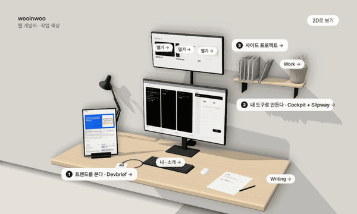

<picture>
  <source media="(min-width: 768px)" srcset="assets/profile-wide.svg">
  
</picture>
<picture>
  <source media="(min-width: 768px)" srcset="assets/blank.svg">
  
</picture>

 

### 작업 책상

[3D 책상](https://wooki.cc/desk-preview/) · [포트폴리오](https://wooki.cc) · [글](https://wooki.cc/blog/)

